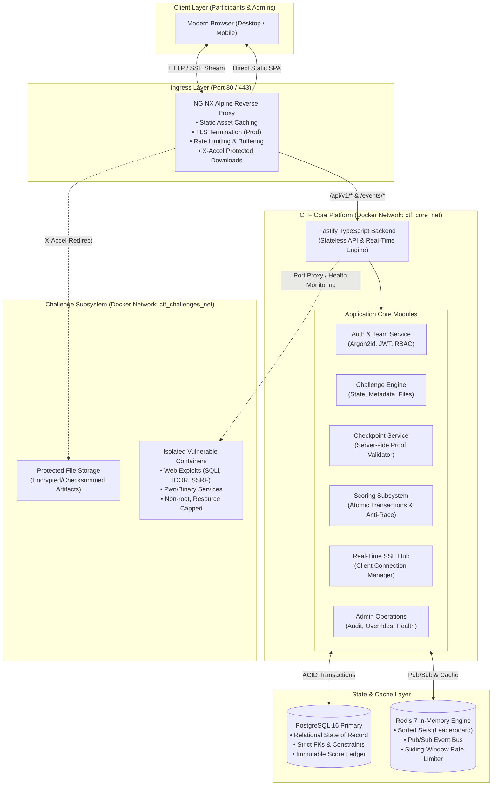
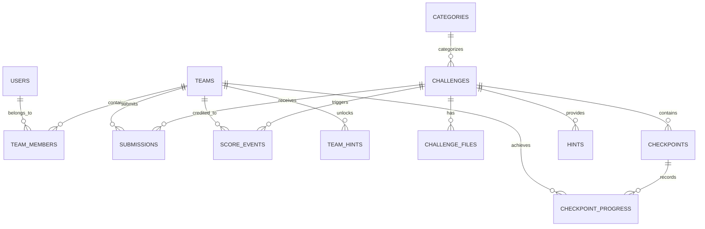

# TECHX CTF 2026 — Comprehensive System Architecture & Engineering Plan

> **For Reviewers & IEEE Event Organizers:**  
> This specification defines the architecture, data model, real-time pipeline, security controls, and stage-gated roadmap for the **TechX Madras 2026 Capture The Flag (CTF) Platform**.  
> Designed to support **200–400+ concurrent participants (load tested to 800+)** across both **offline College LAN environments** and **cloud-hosted production servers** using a single, unified codebase.

---

## Executive Summary & Non-Functional Mandates

| Requirement | Specification | Enforcement Mechanism |
| :--- | :--- | :--- |
| **Concurrency Target** | 200–400 active concurrent users; peak 800+ | Non-blocking async event loop, connection pooling, Redis caching |
| **Deployment Model** | Single unified codebase for **LAN/Laptop** and **VPS Server** | Environment variables (`DEPLOYMENT_MODE=lan\|prod`), Docker Compose overlays |
| **Offline Independence** | 100% functional without external internet | Self-hosted assets (fonts, icons, JS bundles); zero external CDN dependencies |
| **Leaderboard Latency** | Sub-second real-time score updates to all clients | Server-Sent Events (SSE) + Redis Pub/Sub; debounced delta broadcasts |
| **Scoring Integrity** | Zero double-scoring, race-condition proof, auditable | PostgreSQL transactions with `SELECT ... FOR UPDATE`, immutable score ledger |
| **Challenge Isolation**| Vulnerable containers cannot compromise the platform | Independent Docker bridge networks, capability stripping, CPU/RAM limits |
| **Visual Identity** | Official TechX IEEE aesthetic | Deep black/dark foundation with `#6a1b9a` accent, crisp typography, clean UX |

---

## Section A: Technology Stack Evaluation & Recommendation

We evaluated three primary backend runtime candidates against the non-functional constraints of TechX CTF 2026:

### Comparative Analysis

| Criteria | Option 1: Python (FastAPI + SQLAlchemy) | Option 2: Go (Golang + Chi/pgx) | Option 3: TypeScript (Node.js + Fastify) **[RECOMMENDED]** |
| :--- | :--- | :--- | :--- |
| **Throughput & Concurrency** | Moderate (~8k–12k req/s). Async I/O is good, but CPU-intensive tasks (Argon2id hashing) block the GIL without thread pools. | Maximum (~40k–60k req/s). Goroutines handle 50k+ connections with negligible memory. | High (~30k–45k req/s). Fastify schema compilation (`fast-json-stringify`) outperforms Express and FastAPI. |
| **Real-Time Streaming** | Starlette SSE/WebSockets. Requires careful worker tuning with Uvicorn/Gunicorn. | Native channel-based streaming; extremely low memory per connection. | Native streaming (`@fastify/websocket`, SSE streams). 400 SSE connections take <25MB RAM. |
| **Database & Transactions** | SQLAlchemy 2.0 async is mature but verbose; session lifecycles can be tricky under high concurrency. | SQLC / raw SQL with pgx is rock-solid and fast, but requires substantial boilerplate for dynamic queries. | **Drizzle ORM** provides type-safe SQL with zero runtime overhead, explicit transactions, and row-level locking (`FOR UPDATE`). |
| **AI Agent & Dev Productivity**| High; very readable. | Moderate; strict typing but high verbosity and slow prototyping of complex admin CRUD. | **Maximum**. Fullstack TypeScript provides unified schemas (Zod DTOs shared between backend and frontend). |
| **LAN / Laptop Footprint** | Moderate. Python Alpine images require build tools for C-extensions (`bcrypt`, `cryptography`). | Minimal. Single static binary, no runtime dependencies. | Minimal. Node Alpine image is ~140MB; instant startup, rock-solid on Windows/Linux Docker. |
| **Security Ecosystem** | Extensive tooling, but potential GIL starvation during login bursts. | Memory-safe, strict static compilation, minimal attack surface. | Strict Zod validation at controller boundaries, constant-time crypto via Node `crypto.timingSafeEqual`. |

### Final Technology Recommendation

1. **Backend Core**: **Node.js (v20+ LTS) with Fastify & TypeScript**
   - *Rationale*: Fastify provides up to 4x the throughput of Express, built-in JSON schema validation, native SSE support, and seamless integration with TypeScript.
2. **Database Engine**: **PostgreSQL 16**
   - *Rationale*: ACID compliance, strict constraints, robust row-level locking (`SELECT ... FOR UPDATE`), and immutable audit trails.
3. **Cache & Event Bus**: **Redis 7 (or Valkey)**
   - *Rationale*: O(log N) leaderboard ranking via Sorted Sets (`ZSET`), sub-millisecond pub/sub for real-time fan-out, and atomic sliding-window rate limiting via Lua scripts.
4. **Data Access Layer**: **Drizzle ORM + `pg` Connection Pool**
   - *Rationale*: Zero overhead, direct SQL control, type-safe schema definitions, and explicit transaction semantics without the heavy binary bloat of Prisma.
5. **Frontend Architecture**: **React 18/19 + Vite + TypeScript**
   - *Rationale*: Built into a purely static SPA bundle (HTML/CSS/JS) served directly by NGINX. Completely immune to SSR crashes and 100% operational offline.
6. **Reverse Proxy & Ingress**: **NGINX Alpine**
   - *Rationale*: Handles static file delivery, gzip/brotli compression, SSL termination in production, and internal `X-Accel-Redirect` for secure challenge file downloads.

---

## Section B: Complete System Architecture



### Component Breakdown & Data Flow

1. **Ingress (NGINX)**:
   - Evaluates incoming requests. Static requests (`/`, `/assets/*`) are served immediately from NGINX's filesystem cache.
   - Dynamic API calls (`/api/v1/*`) and event streams (`/api/v1/events/stream`) are forwarded to the Fastify upstream with persistent HTTP keep-alive.
2. **Core API (Fastify)**:
   - Validates all request payloads using precompiled Zod/JSON schemas.
   - Authenticates sessions using cryptographically signed HTTP-only cookies / Bearer JWTs.
   - Enforces role-based access control (Admin vs Team Member vs Guest).
3. **Scoring & Checkpoint Engine**:
   - Submissions trigger isolated, short-lived database transactions with row-level locks.
   - Once validated, score events are recorded and published to Redis Pub/Sub in <10ms.
4. **Real-Time Leaderboard**:
   - Client browsers maintain an active SSE stream. When Redis receives an event, all subscribed Fastify instances write an SSE frame to connected clients.
5. **Challenge Sandboxing**:
   - Dynamic vulnerable services run on an isolated Docker network (`ctf_challenges_net`) with no bridge to PostgreSQL or Redis.

---

## Section C: Database Design (PostgreSQL 16)

The schema is normalized, heavily constrained, and designed around an **immutable financial-style ledger** for scores.



### Table Definitions & Constraints

#### 1. `users`
- `id`: `UUID PRIMARY KEY DEFAULT gen_random_uuid()`
- `username`: `VARCHAR(50) UNIQUE NOT NULL`
- `email`: `VARCHAR(255) UNIQUE NOT NULL`
- `password_hash`: `VARCHAR(255) NOT NULL` (Argon2id)
- `role`: `VARCHAR(20) NOT NULL DEFAULT 'participant'` (`participant`, `admin`, `superadmin`)
- `is_active`: `BOOLEAN NOT NULL DEFAULT true`
- `created_at`: `TIMESTAMPTZ NOT NULL DEFAULT NOW()`
- `updated_at`: `TIMESTAMPTZ NOT NULL DEFAULT NOW()`
- *Indexes*: `idx_users_username`, `idx_users_email`

#### 2. `teams`
- `id`: `UUID PRIMARY KEY DEFAULT gen_random_uuid()`
- `name`: `VARCHAR(100) UNIQUE NOT NULL`
- `invite_code_hash`: `VARCHAR(255) NOT NULL` (Bcrypt/Argon2 of secret join phrase)
- `captain_id`: `UUID NOT NULL REFERENCES users(id)`
- `score`: `INTEGER NOT NULL DEFAULT 0`
- `last_score_at`: `TIMESTAMPTZ NOT NULL DEFAULT NOW()` *(Crucial: Primary tie-breaker)*
- `is_banned`: `BOOLEAN NOT NULL DEFAULT false`
- `created_at`: `TIMESTAMPTZ NOT NULL DEFAULT NOW()`
- *Indexes*: `idx_teams_score_tiebreak (score DESC, last_score_at ASC)`, `idx_teams_name`

#### 3. `team_members`
- `id`: `UUID PRIMARY KEY DEFAULT gen_random_uuid()`
- `team_id`: `UUID NOT NULL REFERENCES teams(id) ON DELETE CASCADE`
- `user_id`: `UUID NOT NULL UNIQUE REFERENCES users(id) ON DELETE CASCADE` *(User can only belong to one team)*
- `joined_at`: `TIMESTAMPTZ NOT NULL DEFAULT NOW()`
- *Indexes*: `idx_team_members_team_id`

#### 4. `categories`
- `id`: `UUID PRIMARY KEY DEFAULT gen_random_uuid()`
- `name`: `VARCHAR(50) UNIQUE NOT NULL` (`Web`, `Crypto`, `Forensics`, `Reverse`, `Pwn`, `OSINT`, `Linux`)
- `slug`: `VARCHAR(50) UNIQUE NOT NULL`
- `display_order`: `INTEGER NOT NULL DEFAULT 0`

#### 5. `challenges`
- `id`: `UUID PRIMARY KEY DEFAULT gen_random_uuid()`
- `category_id`: `UUID NOT NULL REFERENCES categories(id)`
- `slug`: `VARCHAR(100) UNIQUE NOT NULL`
- `title`: `VARCHAR(150) NOT NULL`
- `description`: `TEXT NOT NULL`
- `story`: `TEXT`
- `difficulty`: `VARCHAR(20) NOT NULL` (`beginner`, `intermediate`, `expert`)
- `points`: `INTEGER NOT NULL CHECK (points >= 0)`
- `flag_hash`: `VARCHAR(255) NOT NULL` (SHA-256 with per-challenge salt or Argon2id)
- `is_dynamic_hmac`: `BOOLEAN NOT NULL DEFAULT false` *(Enables team-specific flags)*
- `status`: `VARCHAR(20) NOT NULL DEFAULT 'draft'` (`draft`, `published`, `hidden`, `archived`)
- `release_time`: `TIMESTAMPTZ`
- `max_attempts`: `INTEGER DEFAULT NULL` *(NULL = unlimited)*
- `author`: `VARCHAR(100) NOT NULL`
- `connection_info`: `TEXT` *(e.g., `nc 192.168.1.50 30001` or web URL)*
- `solve_count`: `INTEGER NOT NULL DEFAULT 0`
- `created_at`: `TIMESTAMPTZ NOT NULL DEFAULT NOW()`
- `updated_at`: `TIMESTAMPTZ NOT NULL DEFAULT NOW()`
- *Indexes*: `idx_challenges_status_category`, `idx_challenges_slug`

#### 6. `challenge_files`
- `id`: `UUID PRIMARY KEY DEFAULT gen_random_uuid()`
- `challenge_id`: `UUID NOT NULL REFERENCES challenges(id) ON DELETE CASCADE`
- `filename`: `VARCHAR(255) NOT NULL`
- `file_path`: `VARCHAR(500) NOT NULL`
- `file_size_bytes`: `BIGINT NOT NULL`
- `sha256_checksum`: `CHAR(64) NOT NULL`
- `is_protected`: `BOOLEAN NOT NULL DEFAULT true`

#### 7. `checkpoints`
- `id`: `UUID PRIMARY KEY DEFAULT gen_random_uuid()`
- `challenge_id`: `UUID NOT NULL REFERENCES challenges(id) ON DELETE CASCADE`
- `step_number`: `SMALLINT NOT NULL CHECK (step_number > 0)`
- `title`: `VARCHAR(150) NOT NULL`
- `description`: `TEXT NOT NULL`
- `point_value`: `INTEGER NOT NULL DEFAULT 0 CHECK (point_value >= 0)`
- `validation_type`: `VARCHAR(30) NOT NULL` (`token_proof`, `server_callback`, `sub_flag`)
- `secret_proof_hash`: `VARCHAR(255) NOT NULL`
- `created_at`: `TIMESTAMPTZ NOT NULL DEFAULT NOW()`
- *Constraints*: `UNIQUE(challenge_id, step_number)`

#### 8. `checkpoint_progress`
- `id`: `UUID PRIMARY KEY DEFAULT gen_random_uuid()`
- `team_id`: `UUID NOT NULL REFERENCES teams(id) ON DELETE CASCADE`
- `checkpoint_id`: `UUID NOT NULL REFERENCES checkpoints(id) ON DELETE CASCADE`
- `user_id`: `UUID NOT NULL REFERENCES users(id)`
- `solved_at`: `TIMESTAMPTZ NOT NULL DEFAULT NOW()`
- `proof_metadata`: `JSONB`
- *Constraints*: `UNIQUE(team_id, checkpoint_id)` *(Guarantees checkpoint awarded once per team)*

#### 9. `submissions`
- `id`: `UUID PRIMARY KEY DEFAULT gen_random_uuid()`
- `team_id`: `UUID NOT NULL REFERENCES teams(id) ON DELETE CASCADE`
- `user_id`: `UUID NOT NULL REFERENCES users(id)`
- `challenge_id`: `UUID NOT NULL REFERENCES challenges(id) ON DELETE CASCADE`
- `checkpoint_id`: `UUID REFERENCES checkpoints(id)` *(NULL if final flag)*
- `submitted_flag`: `VARCHAR(500) NOT NULL`
- `is_correct`: `BOOLEAN NOT NULL`
- `ip_address`: `INET NOT NULL`
- `user_agent`: `TEXT`
- `created_at`: `TIMESTAMPTZ NOT NULL DEFAULT NOW()`
- *Indexes*: `idx_submissions_team_chal (team_id, challenge_id)`, `idx_submissions_created (created_at DESC)`

#### 10. `team_solves` *(Materialized solve table for fast lookups & unique constraints)*
- `id`: `UUID PRIMARY KEY DEFAULT gen_random_uuid()`
- `team_id`: `UUID NOT NULL REFERENCES teams(id) ON DELETE CASCADE`
- `challenge_id`: `UUID NOT NULL REFERENCES challenges(id) ON DELETE CASCADE`
- `solved_by_user_id`: `UUID NOT NULL REFERENCES users(id)`
- `solved_at`: `TIMESTAMPTZ NOT NULL DEFAULT NOW()`
- *Constraints*: `UNIQUE(team_id, challenge_id)` *(Absolute database guarantee against double-solving)*

#### 11. `score_events` *(Immutable Accounting Ledger)*
- `id`: `UUID PRIMARY KEY DEFAULT gen_random_uuid()`
- `team_id`: `UUID NOT NULL REFERENCES teams(id) ON DELETE CASCADE`
- `challenge_id`: `UUID REFERENCES challenges(id)`
- `checkpoint_id`: `UUID REFERENCES checkpoints(id)`
- `hint_id`: `UUID REFERENCES hints(id)`
- `event_type`: `VARCHAR(30) NOT NULL` (`final_solve`, `checkpoint_solve`, `hint_penalty`, `admin_adjustment`)
- `points`: `INTEGER NOT NULL` *(Can be positive or negative for penalties)*
- `running_team_score`: `INTEGER NOT NULL`
- `created_at`: `TIMESTAMPTZ NOT NULL DEFAULT NOW()`
- *Indexes*: `idx_score_events_team_created (team_id, created_at ASC)`

#### 12. `hints` & `team_hints`
- `hints`: `(id, challenge_id, order_num, content, penalty_points)`
- `team_hints`: `(id, team_id, hint_id, unlocked_by_user_id, unlocked_at)` with `UNIQUE(team_id, hint_id)`

#### 13. `audit_logs` & `system_config`
- `audit_logs`: `(id, actor_id, actor_ip, action, entity_type, entity_id, details, created_at)`
- `system_config`: `(key VARCHAR(100) PRIMARY KEY, value JSONB, updated_at)` *(Competition state: `frozen`, `active`, `ended`)*

---

## Section D: API Architecture & Endpoint Specification

All endpoints are grouped under `/api/v1` and strictly validate input schemas via Zod.

### 1. Authentication & Team Management (`/api/v1/auth`, `/api/v1/teams`)
- `POST /auth/register` — Create user account with Argon2id password hash.
- `POST /auth/login` — Authenticate, return secure HTTP-only session cookie or Bearer JWT.
- `POST /auth/logout` — Invalidate session in Redis.
- `GET  /auth/me` — Return authenticated user profile and team affiliation.
- `POST /teams/create` — Create a new team (caller becomes captain).
- `POST /teams/join` — Join team using secret invite code (checks member cap, e.g., max 4).
- `GET  /teams/me` — Return current team details, member roster, and solve history.
- `POST /teams/leave` — Leave team (restricted if competition is active or user is captain).

### 2. Challenges & Checkpoints (`/api/v1/challenges`, `/api/v1/checkpoints`)
- `GET  /challenges` — List published challenges (title, category, difficulty, points, solve count, solved status). *Flags, internal secrets, and solutions are completely stripped from response*.
- `GET  /challenges/:slug` — Retrieve challenge description, story, connection info, hints, and checkpoints.
- `GET  /challenges/:slug/files/:fileId` — Authenticated file download ticket. Returns `X-Accel-Redirect` to NGINX.
- `POST /challenges/:slug/hints/:hintId/unlock` — Deduct penalty points and reveal hint.
- `POST /checkpoints/:checkpointId/validate` — Submit cryptographic checkpoint proof or token. Validates step prerequisites.

### 3. Submissions & Scoring (`/api/v1/submissions`)
- `POST /submissions/flag` — Submit final challenge flag.
  - **Rate Limit**: Max 5 attempts per 30 seconds per team.
  - **Transaction**: Locks `team_solves` for update, verifies flag hash using constant-time comparison, writes `score_events`, updates `teams.score` and `teams.last_score_at`, broadcasts to Redis.

### 4. Leaderboard & Real-Time Events (`/api/v1/leaderboard`, `/api/v1/events`)
- `GET /leaderboard` — Paginated scoreboard (rank, team name, total score, solves, last score timestamp). Cached in Redis with 3s TTL.
- `GET /leaderboard/progression` — Top 10 teams' score history timeline for scoreboard chart rendering.
- `GET /events/stream` — **Server-Sent Events (SSE)** endpoint. Establishes long-lived connection for real-time announcements, solve ticker, and score deltas.

### 5. Admin Panel (`/api/v1/admin/*`)
- `GET/POST/PUT /admin/challenges` — Full CRUD on challenges, draft/publish toggles, flag inspection.
- `GET/PUT      /admin/teams` — View team rosters, ban/unban, manual score adjustments with mandatory audit note.
- `GET          /admin/submissions` — Live searchable feed of all incoming flags/attempts (filter by team, challenge, correct/incorrect).
- `POST         /admin/announcements` — Broadcast instant notification to all active participants via SSE.
- `POST         /admin/system/state` — Toggle competition state (`active`, `frozen`, `paused`, `ended`).
- `GET          /admin/health` — Platform telemetry (DB pool status, Redis memory, active SSE clients, challenge container health).

---

## Section E: Real-Time Event Pipeline & Leaderboard Synchronization

```mermaid
sequenceDiagram
    autonumber
    actor Player as Participant (Team A)
    participant API as Fastify Backend
    participant DB as PostgreSQL 16
    participant Redis as Redis Pub/Sub & ZSET
    participant SSE as Connected Clients (All Teams)

    Player->>API: POST /api/v1/submissions/flag {slug, flag}
    Note over API: Rate Limiter Check (Redis Lua)<br/>Zod Input Validation

    rect rgb(30, 30, 40)
        Note over API,DB: ATOMIC TRANSACTION (SERIALIZABLE / FOR UPDATE)
        API->>DB: SELECT * FROM team_solves WHERE team_id = A AND challenge_id = X FOR UPDATE
        alt Already Solved
            DB-->>API: Row exists
            API-->>Player: 200 OK { status: "already_solved", points: 0 }
        else First Correct Solve
            API->>API: crypto.timingSafeEqual(submittedHash, targetHash)
            API->>DB: INSERT INTO team_solves (team_id, challenge_id)
            API->>DB: INSERT INTO score_events (team_id, points, ...)
            API->>DB: UPDATE teams SET score = score + P, last_score_at = NOW()
            API->>DB: UPDATE challenges SET solve_count = solve_count + 1
            DB-->>API: Transaction Committed
        end
    end

    API-->>Player: 200 OK { status: "correct", pointsAwarded: P }

    par Broadcast Pipeline
        API->>Redis: ZINCRBY ctf:leaderboard P "team:A"
        API->>Redis: PUBLISH ctf:events { type: "SOLVE_EVENT", teamId: A, chal: X, points: P, timestamp }
        Redis-->>API: Pub/Sub message received by worker instances
        API->>SSE: Send SSE Data Frame: "event: solve\ndata: {...}\n\n"
        Note over SSE: Client browsers update Ticker & Re-sort Scoreboard locally
    end
```



### Why Server-Sent Events (SSE) instead of raw WebSockets?
1. **Unidirectional Efficiency**: 99.9% of CTF real-time communication is server-to-client (announcements, scoreboard deltas, solve notifications). Submissions remain standard HTTP POST requests with full idempotency, rate limiting, and standard HTTP error codes.
2. **Proxy & LAN Resilience**: SSE operates over plain HTTP/1.1 or HTTP/2. It does not require protocol upgrade handshakes (`Upgrade: websocket`) that frequently fail on strict college firewalls, captive portals, or cheap unmanaged switches.
3. **Automatic Reconnection**: Browsers natively reconnect to SSE endpoints with `Last-Event-ID`, resuming missed messages seamlessly after temporary Wi-Fi blips.

---

## Section F: Dual-Environment Deployment Model

The platform operates identically on a single laptop on a college LAN or on a multi-core cloud VM.

```
                    ┌──────────────────────────────────────────────┐
                    │               SHARED CODEBASE                │
                    │   (Fastify Backend + React Vite SPA Bundle)  │
                    └──────────────────────┬───────────────────────┘
                                           │
                    ┌──────────────────────┴───────────────────────┐
                    ▼                                             ▼
       ┌─────────────────────────┐                   ┌─────────────────────────┐
       │   ENVIRONMENT A: LAN    │                   │  ENVIRONMENT B: SERVER  │
       │   (College Switch/PC)   │                   │   (Cloud VM / VPS)      │
       ├─────────────────────────┤                   ├─────────────────────────┤
       │ • docker-compose.lan.yml│                   │ • docker-compose.prod.yml│
       │ • NGINX on 0.0.0.0:80   │                   │ • NGINX with TLS (443)  │
       │ • Offline bundled fonts │                   │ • Let's Encrypt Certbot │
       │ • Local IP / mDNS host  │                   │ • Public Domain / DNS   │
       │ • Zero internet access  │                   │ • Strict CORS & HSTS    │
       └─────────────────────────┘                   └─────────────────────────┘
```

### Environment A: College LAN / Laptop Mode
- **Zero Internet Requirement**: Web fonts (`Inter`, `JetBrains Mono`) are self-hosted inside `/frontend/src/assets/fonts` and loaded via CSS `@font-face`. No external CDNs (Google Fonts, unpkg, cdnjs) are queried.
- **Network Interface Binding**: NGINX binds to `0.0.0.0:80`. The host PC connects to the college Ethernet switch.
- **Addressability**: Participants navigate to `http://192.168.1.50` (host static IP) or `http://techx-ctf.local` (via mDNS / Avahi broadcast).
- **Graceful Laptop Operations**: Docker volumes persist on the host drive. If the laptop is unplugged or restarted, `docker compose -f docker-compose.yml -f docker-compose.lan.yml up -d` restores the entire state in under 15 seconds.

### Environment B: Production Server Mode
- **Edge Security**: NGINX listens on ports 80 and 443 with automated Let's Encrypt certificates.
- **Strict Headers**: `HSTS`, `X-Content-Type-Options: nosniff`, `X-Frame-Options: DENY`, `Content-Security-Policy`.
- **Database Backup**: Automated cron script dumping PostgreSQL database to encrypted tarballs every 30 minutes.

---

## Section G: Security Model & Threat Mitigation

| Threat / Attack Vector | Specific Risk | Platform Mitigation |
| :--- | :--- | :--- |
| **Flag Guessing / Brute Force** | Automated scripts spamming flags | Redis sliding-window rate limiting (5 attempts / 30s per team). Exponential lockout after 10 consecutive failed attempts. |
| **Timing Attacks on Flags** | Microsecond differences in string comparison reveal flag characters | Constant-time comparison using `crypto.timingSafeEqual(Buffer.from(a), Buffer.from(b))` with fixed-length digests. |
| **Flag Leakage via Frontend** | Participant inspects network tab or source maps | Flags are **never** delivered to client browsers. Challenge payloads only contain title, markdown description, author, and hints. |
| **Race Conditions / Double Solving** | Two team members submit the flag at the exact same millisecond | PostgreSQL unique constraint `UNIQUE(team_id, challenge_id)` on `team_solves` + `SELECT ... FOR UPDATE` row-level locks. |
| **Forged Checkpoint Claims** | User invokes `POST /checkpoint` claiming completion | Server-side validation only. Checkpoints require verifiable proofs (e.g., token signed with challenge HMAC or output validation). |
| **Cross-Team State Tampering (IDOR)**| Player attempts to unlock hints or view private progress of rival team | Auth middleware injects verified `team_id` from JWT session. All DB queries strictly enforce `WHERE team_id = req.user.team_id`. |
| **Vulnerable Challenge Escape** | Participant exploits a Web/Pwn challenge and breaks out into CTF core | Containers run on isolated Docker bridge network `ctf_challenges_net` with `cap_drop: ALL`, `pids_limit: 100`, read-only root, no access to DB. |
| **Admin Privilege Escalation** | Competitor discovers administrative endpoints | RBAC middleware checks `user.role === 'admin'`. Admin routes mounted on separate prefix with independent audit logging. |

---

## Section H: Performance Model & Bottleneck Analysis (400–800 Users)

### Identifying Potential Bottlenecks

1. **Password Hashing Spikes (Argon2id)**:
   - *Risk*: At competition launch (09:00 AM), 400 participants login within 2 minutes. Argon2id is intentionally CPU-intensive; 400 simultaneous hashes can saturate all CPU cores and delay HTTP requests.
   - *Mitigation*: Offload password verification to a dedicated worker thread pool (`worker_threads` / `piscina`) capped at `CPU_CORES - 1`. Session tokens (JWTs in HTTP-only cookies) handle subsequent requests without re-hashing.
2. **Database Connection Pool Exhaustion**:
   - *Risk*: Hundreds of concurrent requests consume PostgreSQL connections (`max_connections` reached).
   - *Mitigation*: Fastify uses `pg-pool` tuned to 30–50 connections with short checkout times. Read-only queries (challenge list, announcements) are served from Redis cache.
3. **Leaderboard Polling Congestion**:
   - *Risk*: 400 clients pressing F5 to see updated scores.
   - *Mitigation*: SSE pushes score updates instantly. The raw leaderboard endpoint is cached in Redis with a 3-second TTL and NGINX micro-caching (`proxy_cache_valid 200 2s`).
4. **Challenge File Download Bandwidth**:
   - *Risk*: 100 participants downloading a 150MB forensics PCAP simultaneously saturates the LAN switch.
   - *Mitigation*: NGINX handles file streaming using Linux kernel `sendfile` via `X-Accel-Redirect`. Download bandwidth is throttled to 10MB/s per connection (`limit_rate 10m`).

---

## Section I: Challenge Infrastructure & Sandboxing

Challenges are categorized into two architectural tiers:

### Tier 1: Static / Artifact Challenges (Forensics, Crypto, Reverse, OSINT)
- Artifact files (PCAPs, disk images, binaries, encrypted ciphers) reside in a protected directory `/data/challenges/static/`.
- Accessible only through `/api/v1/challenges/:slug/files/:fileId`.
- The Fastify backend validates team authentication, verifies the challenge is currently `published`, and sends an internal NGINX header:
  ```http
  X-Accel-Redirect: /protected_storage/forensics_evidence.pcap
  Content-Disposition: attachment; filename="forensics_evidence.pcap"
  ```
- NGINX intercepts this header and streams the file directly from disk without consuming backend memory.

### Tier 2: Dynamic / Vulnerable Interactive Challenges (Web, Binary Pwn, Linux)
- Packaged as standalone Docker containers running under `docker-compose.challenges.yml`.
- Placed on an isolated Docker bridge network (`ctf_challenges_net`) with `internal: true` (no outbound internet) and no routing to the `ctf_core_net` (Postgres/Redis).
- Security Constraints applied to every vulnerable container:
  ```yaml
  security_opt:
    - no-new-privileges:true
  cap_drop:
    - ALL
  cap_add:
    - CHOWN
    - SETUID
    - SETGID
  mem_limit: 128m
  cpus: 0.25
  pids_limit: 100
  read_only: true
  tmpfs:
    - /tmp:rw,noexec,nosuid,size=32m
  ```

---

## Section J: Proposed Repository Structure

```
TechX-CTF/
├── .env.example
├── README.md
├── docker-compose.yml              # Base service configurations
├── docker-compose.lan.yml          # College LAN environment overlay
├── docker-compose.prod.yml         # Production server environment overlay
├── docker-compose.challenges.yml    # Sandboxed challenge container definitions
├── docker/
│   ├── nginx/
│   │   ├── Dockerfile
│   │   ├── nginx.lan.conf
│   │   └── nginx.prod.conf
│   └── backend/
│       └── Dockerfile
├── backend/
│   ├── package.json
│   ├── tsconfig.json
│   ├── drizzle.config.ts
│   ├── src/
│   │   ├── server.ts               # Entrypoint & graceful shutdown
│   │   ├── app.ts                  # Fastify application factory
│   │   ├── config/                 # Zod-validated environment variables
│   │   ├── db/
│   │   │   ├── index.ts            # Drizzle client & connection pool
│   │   │   ├── schema.ts           # Complete database schema definitions
│   │   │   └── migrate.ts          # Migration runner
│   │   ├── modules/
│   │   │   ├── auth/               # Registration, Login, JWT, Argon2
│   │   │   ├── teams/              # Team creation, invites, roster
│   │   │   ├── challenges/         # Catalog, visibility, file tickets
│   │   │   ├── checkpoints/        # Checkpoint proof validation
│   │   │   ├── submissions/        # Flag submission & rate limiting
│   │   │   ├── scoring/            # Atomic score calculations & ledger
│   │   │   ├── leaderboard/        # Ranking engine, history graph
│   │   │   ├── announcements/      # Broadcast management
│   │   │   └── admin/              # Operational control & monitoring
│   │   ├── real-time/
│   │   │   ├── sse.hub.ts          # Active SSE client connection manager
│   │   │   └── redis.pubsub.ts     # Redis subscriber & event fan-out
│   │   ├── middleware/
│   │   │   ├── auth.middleware.ts
│   │   │   ├── rbac.middleware.ts
│   │   │   └── rate_limiter.ts
│   │   └── utils/
│   │       ├── crypto.ts           # Constant-time comparison, HMAC tokens
│   │       └── logger.ts           # Structured Pino logging
│   └── tests/
│       ├── unit/                   # Scoring, crypto, validation logic
│       ├── integration/            # API endpoints + PostgreSQL test DB
│       └── security/               # Race conditions, IDOR, brute-force tests
├── frontend/
│   ├── package.json
│   ├── tsconfig.json
│   ├── vite.config.ts
│   ├── index.html
│   └── src/
│       ├── assets/                 # Self-hosted fonts, TechX logos, SVG icons
│       ├── styles/                 # Color tokens (black, #6a1b9a purple), globals
│       ├── types/                  # Shared TypeScript API models
│       ├── services/               # Axios/Fetch API client + SSE listener
│       ├── contexts/               # AuthContext, TeamContext, RealTimeContext
│       ├── hooks/                  # useChallenges, useLeaderboard, useToast
│       ├── components/             # Reusable UI primitives (Card, Badge, Modal)
│       └── pages/
│           ├── Landing.tsx
│           ├── Login.tsx
│           ├── Register.tsx
│           ├── TeamDashboard.tsx
│           ├── Challenges.tsx
│           ├── ChallengeModal.tsx
│           ├── Leaderboard.tsx
│           └── Admin/
├── challenges/                     # Challenge source files & descriptions
│   ├── beginner/
│   ├── intermediate/
│   ├── expert/
│   └── manifests/                  # JSON/YAML seed files for database import
├── scripts/
│   ├── seed_challenges.ts          # Automated challenge catalog database loader
│   ├── backup_db.sh                # Backup PostgreSQL database
│   ├── restore_db.sh               # Restore from backup
│   └── health_check.sh             # Comprehensive pre-event diagnostic script
├── tests/
│   └── k6/                         # Load testing suites
│       ├── login_burst.js          # 400 concurrent logins
│       ├── flag_submission_race.js # High-concurrency race condition tests
│       └── leaderboard_flood.js    # 800 continuous SSE client connections
└── docs/
    ├── architecture.md
    ├── lan_setup_guide.md
    ├── server_deployment_guide.md
    └── operator_emergency_runbook.md
```

---

## Section K: Stage-Gated Development Roadmap

Each stage is strictly gated. A stage must be implemented, tested, verified, and reviewed before the next stage begins.

| Stage | Focus Area | Deliverables & Verification Gates |
| :--- | :--- | :--- |
| **Stage 0** | **Architecture Review** *(Current)* | Complete architecture proposal, data model, and engineering plan approval. |
| **Stage 1** | **Platform Foundation** | Monorepo scaffolding, Docker Compose (Base, LAN, Prod), Postgres & Redis setup, Drizzle ORM configuration, Pino logger, health-check endpoint. |
| **Stage 2** | **Authentication & Teams** | User registration/login with Argon2id, JWT session tokens, Team creation, invite codes, membership caps, role-based authorization middleware. Integration tests. |
| **Stage 3** | **Challenge Engine** | Challenge metadata models, category/difficulty filters, status scheduler (draft/published), secure file download tickets with `X-Accel-Redirect`. |
| **Stage 4** | **Checkpoints & Scoring** | Multi-step checkpoint validator, atomic flag submission endpoint, `team_solves` concurrency locks, immutable `score_events` ledger, tie-break ordering. Concurrency race tests. |
| **Stage 5** | **Live Real-Time Leaderboard** | Redis Sorted Sets ranking, Redis Pub/Sub event bus, Fastify Server-Sent Events (SSE) hub, client reconnection handling, score delta broadcasts. |
| **Stage 6** | **Operational Admin Panel** | Admin endpoints: challenge toggles, live submission feed, manual score adjustments, broadcast announcements, event freeze toggle, audit logs. |
| **Stage 7** | **Participant UI / UX** | React SPA: TechX dark theme with `#6a1b9a` accent, offline font bundling, interactive challenge modal, hint unlocks, real-time live ticker and scoreboard. |
| **Stage 8** | **Challenge Infrastructure** | Isolated Docker network setup, sample vulnerable containers with strict resource/security constraints, health probes. |
| **Stage 9** | **Security Audit & Hardening** | Automated penetration testing: timing attack tests, rate limit verification, IDOR validation, cross-team data leaks, container breakout audits. |
| **Stage 10** | **Load & Stress Testing** | k6 load tests: 100 → 200 → 400 → 800 virtual users. Measure p50, p95, p99 latencies, CPU/memory profiles, and connection stability. |
| **Stage 11** | **Deployment Validation** | Clean-slate test deployment on both: (A) Offline Laptop on local Ethernet LAN, and (B) Production VPS with public domain. |
| **Stage 12** | **Event Simulation Drill** | End-to-end simulated CTF: registration, team formation, simultaneous challenge solves, admin announcements, simulated backend crash & 15-second recovery. |

---

## Section L: Architectural Risks & Mitigation Matrix

| Risk Scenario | Probability | Impact | Mitigation Strategy |
| :--- | :--- | :--- | :--- |
| **College Wi-Fi / Switch Outage** | High | Critical | The platform runs on wired Ethernet with static LAN IP (`192.168.1.50`). Completely independent of college internet or external DNS. |
| **Laptop Hardware / Power Loss** | Low | High | All state is persisted in named Docker volumes on SSD. Uninterruptible Power Supply (laptop battery + charger). `docker compose up -d` recovers state in <15 seconds. |
| **Registration / Login Stampede** | High | High | Password hashing worker threads prevent event loop starvation. Pre-event registration allows team credentials to be generated in advance. |
| **Vulnerable Container Crash / Fork Bomb** | High | Medium | Containers are isolated in `ctf_challenges_net` with `restart: unless-stopped`, `pids_limit: 100`, and `mem_limit: 128m`. A crashed challenge container cannot affect the CTF platform. |
| **Malicious Score Tampering Attempt** | Medium | Critical | Scores are never accepted from clients. Derived entirely from the immutable `score_events` table within serializable PostgreSQL transactions. |
| **Accidental Flag Leak via Static Files** | Low | Critical | Static files are protected behind NGINX `internal` directives and authenticated Fastify token endpoints. |

---

## Review & Approval Checkpoint

This completes the **Stage 0 Architectural Specification**.  
Upon explicit user approval, we will proceed to **Stage 1: Foundation (Docker, Database, Redis, and Fastify Scaffolding)**.
